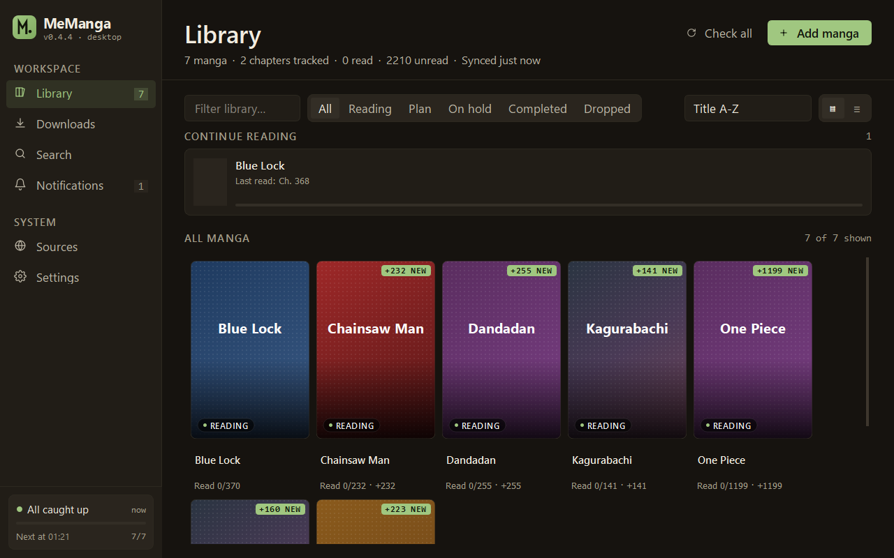
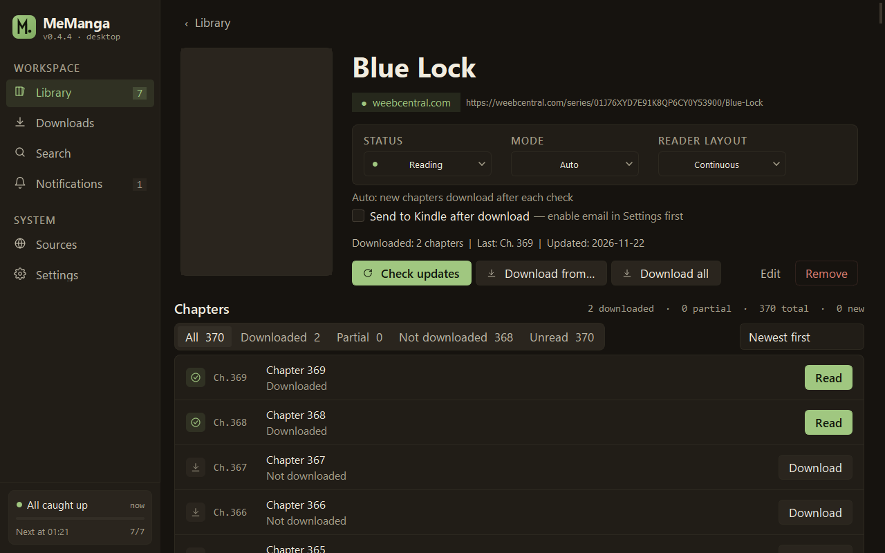
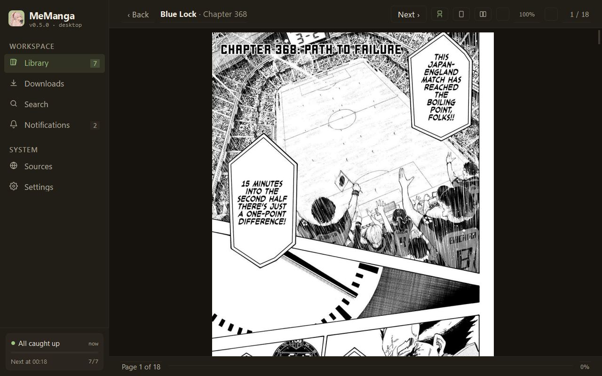
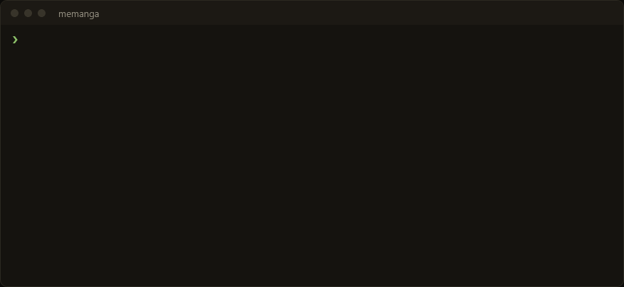

<h1 align="center">MeManga</h1>

  <strong>Keep up with the manga you follow.</strong> 
  Track series, download new chapters and read them in the desktop app, or
  run the same checks from the command line on a server or in Docker.

  
  
  
  

  <a href="https://meellm.github.io/MeManga/"><strong>Documentation</strong></a> ·
  <a href="https://meellm.github.io/MeManga/guide/install"><strong>Download</strong></a> ·
  <a href="https://github.com/meellm/MeManga/discussions"><strong>Discussions</strong></a> ·
  <a href="https://github.com/meellm/MeManga/issues"><strong>Issues</strong></a>

  

## What it does

MeManga keeps a library of the series you follow and checks their sources
for new chapters. It knows
<!-- source-count:start -->239 scrapers / 304 domains<!-- source-count:end -->.

- **Search across sources.** Find a series on many sites at once, and give
  it backup sources for when its main source falls behind or a download
  from it fails.
- **Download your way.** Save chapters as PDF, EPUB, CBZ, ZIP or image
  folders.
- **Read in the app.** The desktop app has its own reader.
- **Send to Kindle.** Deliver chapters to a Kindle by email.
- **Check on a schedule.** Look for new chapters on a computer, a server or
  in Docker.

  
  
   
  Series titles and artwork
  belong to their owners and appear here only to demonstrate the app. See
  <a href="https://meellm.github.io/MeManga/reference/sources#using-sources-responsibly">Using sources responsibly</a>.

## Get started

- **Desktop app** for Windows, macOS or Linux:
  [Download and install](https://meellm.github.io/MeManga/guide/install#desktop-app),
  then [First steps](https://meellm.github.io/MeManga/guide/first-steps) and
  the [desktop manual](https://meellm.github.io/MeManga/desktop/library).
- **Command line**, for example on a server:
  [Command line from source](https://meellm.github.io/MeManga/guide/install#command-line-from-source)
  and [Use the command line](https://meellm.github.io/MeManga/guide/cli).
- **Docker:** [Run MeManga in Docker](https://meellm.github.io/MeManga/guide/docker).
- **Working on MeManga:**
  [Set up for development](https://meellm.github.io/MeManga/developer/contributing)
  and [CONTRIBUTING.md](CONTRIBUTING.md).

  

Installing with `pip`, `pipx` or `uv` from PyPI is
[also available](https://meellm.github.io/MeManga/guide/install#package-installs).
If something does not work, see
[Troubleshooting](https://meellm.github.io/MeManga/guide/troubleshooting).

The documentation follows the development version on the `main` branch,
while the release badge shows the latest download. Pages mark what is not
in the [latest release](https://github.com/meellm/MeManga/releases/latest)
yet, so check those notes before you expect a feature in a download.

## Sources

[Supported websites](https://meellm.github.io/MeManga/reference/supported-websites)
lists every site MeManga has a scraper for, grouped by what it publishes,
and which ones a search includes. The
[technical catalog](https://meellm.github.io/MeManga/reference/sources)
shows how they are checked. Being listed does not mean a site works today:
sites change or go offline without notice. Some sources serve adult
content; the list keeps them in their own section at the end.

MeManga is a tool you run yourself. It does not host any manga and is not
affiliated with the sites it reads; listing a site is not an endorsement.
Use it in line with the terms of those sites, the law where you live and
the rights of the people who make the manga. See
[Using sources responsibly](https://meellm.github.io/MeManga/reference/sources#using-sources-responsibly).

## Project status and contributing

MeManga is developed in public. There is no fixed release schedule and no
guaranteed response time for issues, questions or pull requests.
Contributions are welcome: bug reports and fixes, new and repaired sources,
and [translations](https://meellm.github.io/MeManga/developer/contributing#translations).
Start with [CONTRIBUTING.md](CONTRIBUTING.md).

- Questions and ideas: [Discussions](https://github.com/meellm/MeManga/discussions)
- Bugs and broken sources: [Issues](https://github.com/meellm/MeManga/issues)
- Security problems: [SECURITY.md](SECURITY.md)
- Code of conduct: [CODE_OF_CONDUCT.md](CODE_OF_CONDUCT.md)

You can also maintain a copy of your own. The source code is under the
[MIT license](LICENSE), which lets you use, copy, change and share it as
long as the copyright and permission notice are included.
[Write a scraper](https://meellm.github.io/MeManga/developer/scrapers)
explains how to add or repair a source, and
[Set up for development](https://meellm.github.io/MeManga/developer/contributing)
how to run a copy from source and test it.

## License

MeManga's source code is under the [MIT license](LICENSE).

The desktop downloads and the Docker image also contain third-party
software under its own licenses. The desktop downloads include Qt and
PySide6, which are used under the GNU LGPL.
[Third-party licenses](https://meellm.github.io/MeManga/guide/install#third-party-licenses)
says where the notices and the LGPL source and replacement information are
found.
