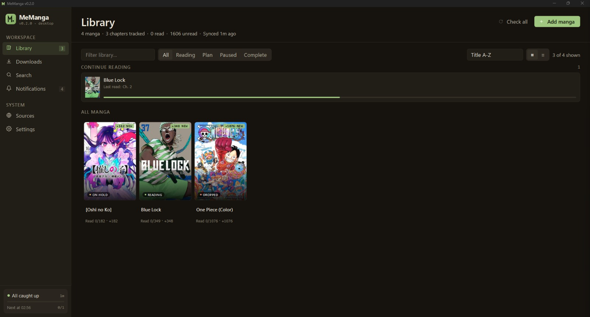
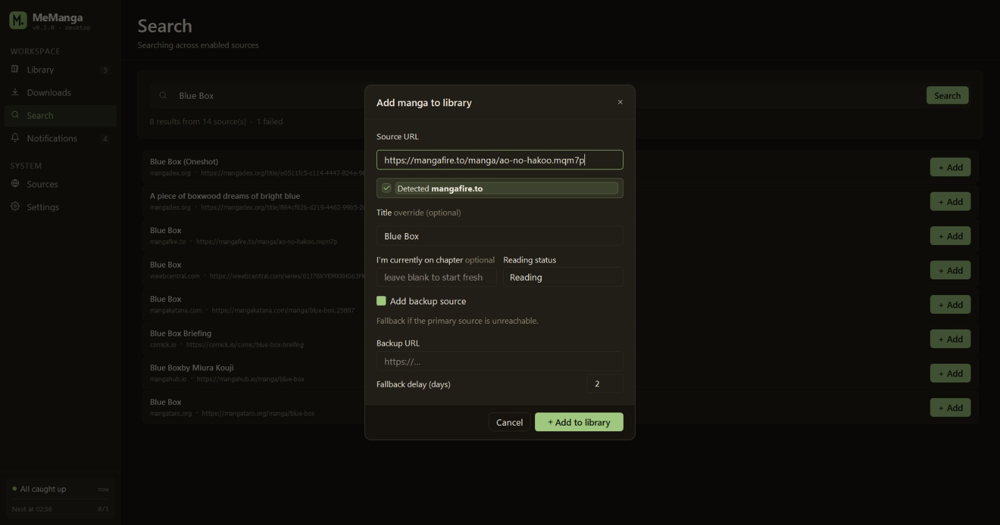
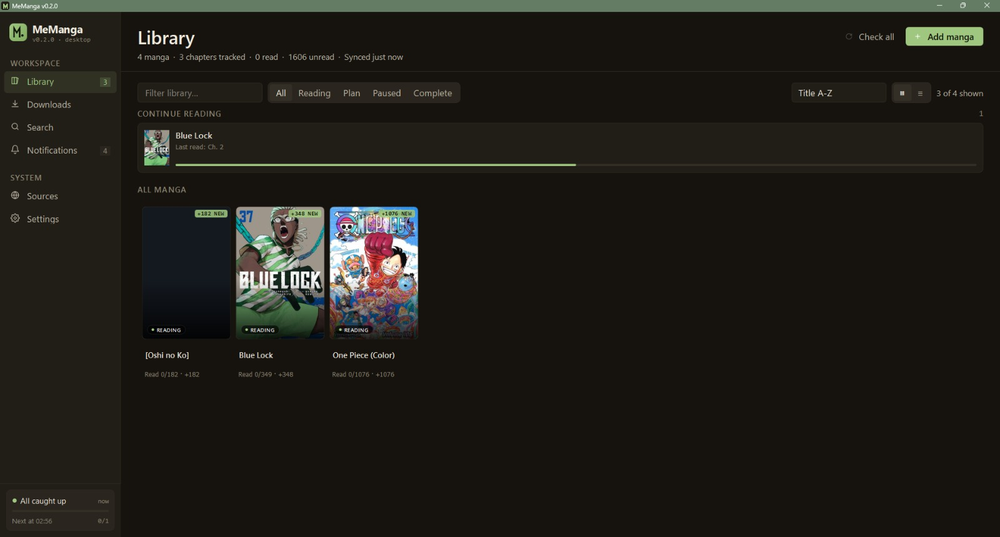
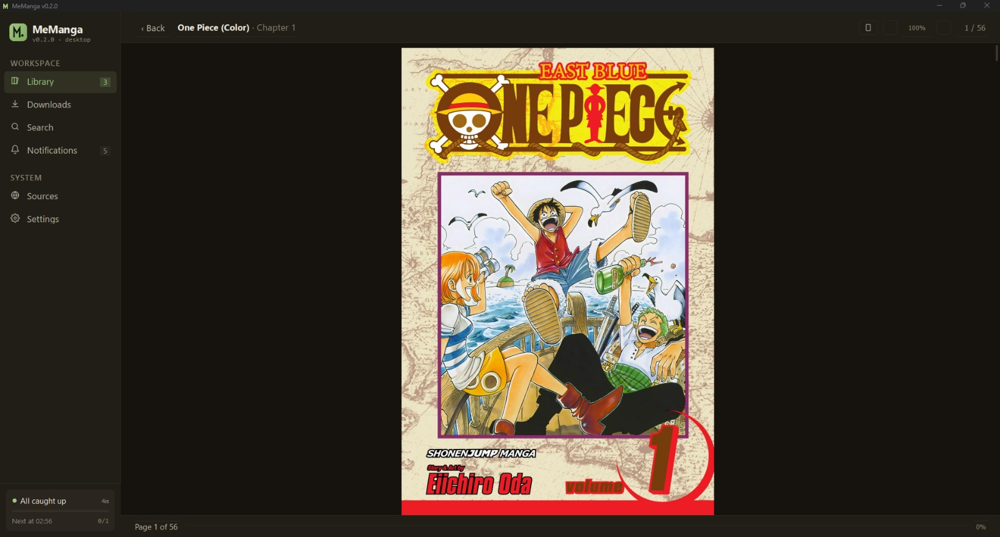
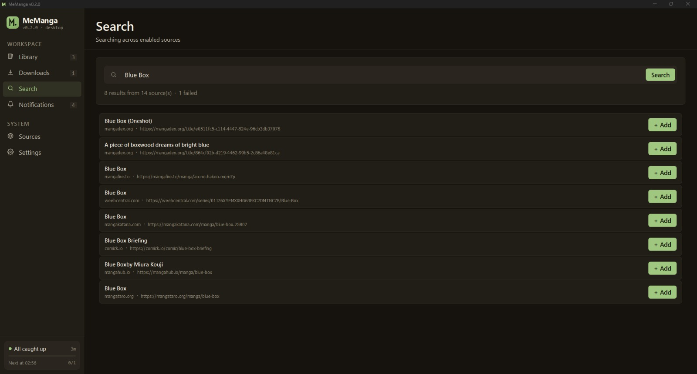
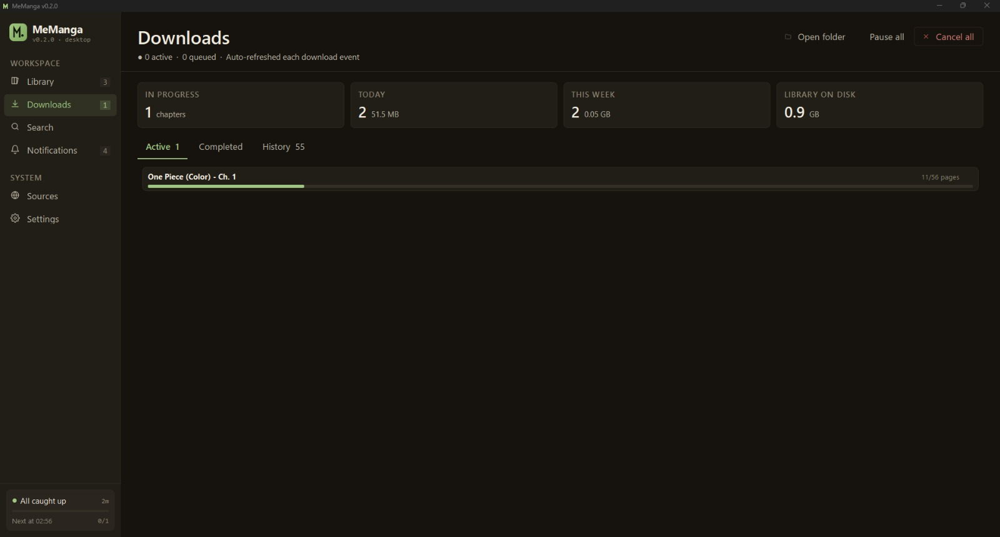
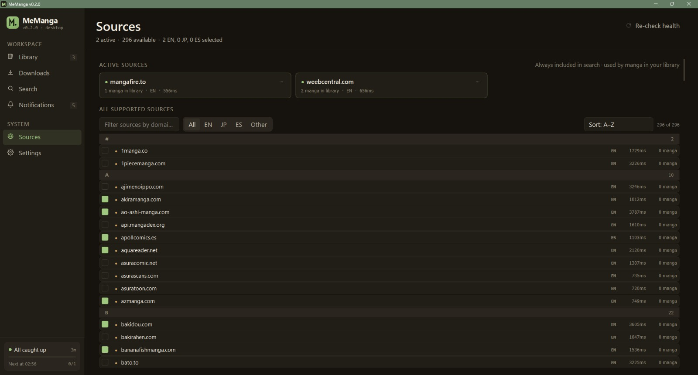
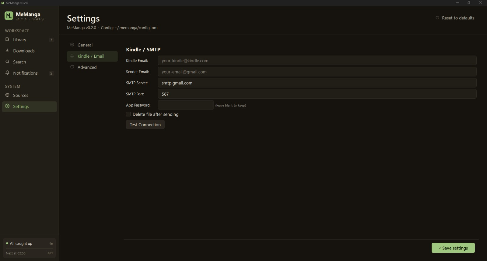

# MeManga

**Automatic manga downloader with a desktop app and a power-user CLI.**

Track manga across 224 scrapers / 319 domains, read downloaded chapters
in the built-in reader, and optionally email them to your Kindle.
Works offline once chapters are downloaded.

<p align="center">
  
</p>

<p align="center">
  <a href="https://github.com/meellm/MeManga/releases"></a>
  <a href="https://github.com/meellm/MeManga/releases"></a>
  <a href="https://hub.docker.com/r/meellm/memanga"></a>
  
  <a href="LICENSE"></a>
</p>

---

## Highlights

- **Portable desktop app** — extract and run `MeManga.exe` / `MeManga` / `MeManga.app`
- **Library tracking** — your read/unread state survives reboots
- **Multi-source search** — 15 popular aggregators pre-checked, ranked by reliability
- **Built-in reader** — zoom, fit-to-page, keyboard nav, no external viewer needed
- **PDF / EPUB / CBZ / ZIP / JPG / PNG / WEBP** output
- **E-Reader delivery** — auto-send chapters by email after download
- **Backup sources** — fall back to a second source if the primary stops updating
- **Offline-aware** — gracefully disables network actions, auto-resumes when wifi returns
- **Power-user CLI** — same engine, scriptable, cron-friendly, works on headless servers
- **No telemetry, no accounts, no cloud** — everything stays on your machine

---

## Download

The fastest path is the release download for your platform.

| OS | File |
|---|---|
| Windows | [`MeManga-windows-x64.zip`](../../releases/latest) |
| macOS (Apple Silicon) | [`MeManga-macos-arm64.zip`](https://github.com/meellm/MeManga/releases/latest) |
| macOS (Intel) | [`MeManga-macos-x64.zip`](https://github.com/meellm/MeManga/releases/latest) |
| Linux (x86_64) | [`MeManga-linux-x64.tar.gz`](https://github.com/meellm/MeManga/releases/latest) |

On Windows the download is a `.zip` — extract it and run `MeManga.exe` from the
`MeManga-windows-x64` folder (keep the `_internal` folder next to it).
On macOS the download is a `.zip` — unzip it to get `MeManga.app`, then double-click.

> **First launch downloads Firefox** (~80 MB download, one-time.)
> Playwright uses it under the hood to scrape JS-heavy sources like MangaFire and WeebCentral.
>
> **Windows SmartScreen** may warn the first time. This is a false positive — the app is safe. Click "More info → Run anyway" to proceed.
> The Windows build is not yet code-signed.
>
> **macOS Gatekeeper** — the Mac app is not code-signed or notarized by Apple (that needs
> a paid Apple Developer account), so macOS may refuse to open it after download.
> If macOS says "MeManga is damaged and can't be opened" or that it can't verify the
> developer, move `MeManga.app` to Applications and run
> `xattr -dr com.apple.quarantine /Applications/MeManga.app` once in Terminal.
>
> **Linux** ships as a `.tar.gz` so the executable bit survives the download —
> a bare binary saves as non-executable and won't launch. Extract, then run:
>
> ```bash
> tar xzf MeManga-linux-x64.tar.gz
> ./MeManga-linux-x64/MeManga
> ```
>
> If a file manager still clears the permission, restore it with
> `chmod +x MeManga-linux-x64/MeManga`.

Each download has a matching `<file>-THIRD_PARTY_NOTICES.txt` on the release
page with the licenses of the third-party software it contains. The same file
is inside `MeManga.app` (`Contents/Resources/THIRD_PARTY_NOTICES.txt`) and at the
top of the Windows and Linux folders.

The desktop app bundles Qt, PySide6, Shiboken6 and img2pdf, which are used under
the GNU LGPL. The notices also reproduce the licenses of PDFium and the other
third-party code built into Qt PDF, which the reader uses for PDF pages. The notices file opens with a section that links the exact source
code of the shipped versions and explains how to use modified versions. On
Windows and Linux the app is a folder rather than a single compressed file, so
these components stay separate files under `_internal` that you can replace; on
macOS you rebuild the app from source with the modified component.

You can also build from the source following [Build from source](#-build-from-source) below.

---

# Part 1 — Desktop App

## First five minutes

When you open MeManga for the first time:

1. The Library page is empty — click **+ Add manga** in the header.
2. Paste a manga URL from any [supported source](docs/SUPPORTED_SOURCES.md), or click **Search** in the sidebar and type the title.
3. The app remembers what you added, what you've downloaded, and what you've read across restarts and across machines
   (config lives in your [MeManga config folder](#where-your-data-lives), you can import/export it).

<p align="center">
  
</p>

## Library

The Library page is the home screen. Cards show the cover, status pill
(`READING`, `COMPLETED`, …), an unread badge when there are new
chapters, and an in-progress bar for the current chapter you're on.

<p align="center">
  
</p>

- Click a card → **Detail** page (chapter list, status, mode, Kindle toggle)
- Right-click → quick actions (mark as read, change status, remove)
- Top-right chip row filters by status; the chip count updates live

## Reader

Click any downloaded chapter on the Detail page to open it in the built-in reader.

<p align="center">
  
</p>

| Key / mouse | Action |
|---|---|
| `↑ ↓` / scroll wheel | Scroll within page |
| `← →` / `Page Up Page Down` | Previous / next chapter |
| `Ctrl/Cmd + scroll` | Zoom in/out |
| `Ctrl/Cmd + 0` | Reset zoom |
| Click-drag while zoomed | Pan |
| `Esc` | Back to Detail |

PDF chapters MeManga wrote show each page's image exactly as stored, at its
original resolution. Any other PDF page, such as one with text, drawings, links
or other annotations, a rotated or cropped page, or a PDF made by another
program, is drawn as a whole page at 150 dpi with Qt PDF, which is part of
Qt. Filled-in form fields are drawn too: their appearance is merged into a
copy of the page in memory first, and the file itself is never changed. A
filled-in field that has no appearance to draw, as in an incomplete form, is
not left out silently: its page shows as a page that couldn't be loaded. A
page that can't be read shows "Page N couldn't be loaded." in its place.
PyMuPDF is not used, even when it is installed.

## Search

Search hits **only the 15 most popular working aggregators by default** —
MangaDex, MangaPill, MangaPark, MangaFire, MangaBuddy, WeebCentral,
MangaKatana, Asura Scans, Comix, Comick, MangaHub, MangaHere, MangaPanda,
MangaHere.onl, MangaTaro. You can always flip more on in the
**Sources** tab if you want a wider net (the long-tail aggregators are
usually slower or have stale catalogs).

<p align="center">
  
</p>

Each result row shows the source domain, a `47 ch` chip telling you
how many chapters that source has, and a `+ Add` button that drops it
straight into your library. You should decide which source to use considering
the chapter number printed there.

## Downloads

The Downloads page shows what's currently downloading and what just
finished. Each row has progress, cancel, and "open folder" buttons.
Cancel-all drains the queue cleanly.

<p align="center">
  
</p>

If a chapter fails partway through, MeManga retries the failed pages
up to 3× with exponential back-off. If pages are still missing, the
chapter is **not** marked as downloaded — next "Check" will pick it
back up.

## Sources

The Sources page shows every supported domain with its current health
status (latency, last successful check, last error). Toggle individual
sources on/off; your selection persists across restarts. Websites might
be dead and still show up in there though. Just a little **warning**.

<p align="center">
  
</p>

Hit **Re-check health** to ping every enabled source and see their status.

## Settings

- **General** — output format (PDF/EPUB/CBZ/…), download folder, theme, concurrency
- **Kindle / Email** — Gmail App Password setup for sending chapters to your Kindle
- **Advanced** — fallback-source delay, post-processing, cron, cache management,
  and **Network & Privacy** (the connection check and MangaDex cover lookup,
  see the [FAQ](#faq)).
  The downloaded desktop app can't set up scheduled checks; use
  `memanga cron install` from the command-line version instead (see
  [Schedule daily checks](#schedule-daily-checks)).

<p align="center">
  
</p>

### Setting up Kindle delivery

1. [Generate a Gmail App Password](https://support.google.com/accounts/answer/185833)
   (regular passwords won't work).
2. Add your Gmail address to your 
   [Amazon "Approved Personal Document E-mail List"](https://www.amazon.com/hz/mycd/myx#/home/settings/payment).
3. In **Settings → Kindle / Email**, paste your Kindle email, sender Gmail,
   and the App Password. **Check Login** only signs in to the mail server and
   sends nothing. **Send Test PDF** emails a one-page test PDF to your Kindle
   (`memanga config email --send-test` does the same from the command line).
   The mail server accepting it does not prove delivery: Amazon delivers it
   only when the sender is on the approved list, so look for
   "MeManga test document" in your Kindle library after a few minutes.
4. In **Settings → General**, choose **Email (send to Kindle)** and which
   manga to send: **Only manga I choose** (selected first, so turning email
   on never sends the whole library) or **Every manga in my library**. A
   manga you already turned Kindle on or off for keeps that choice.
5. With **Only manga I choose**, turn on **Send to Kindle after download**
   on the Detail page of each manga to send. With **Every manga**, turn it
   off for the manga you don't want sent.

Only PDF and EPUB are sent to Kindle; CBZ, ZIP and image folders are saved but not sent. PDFs too large for one email (over 18 MB with the default 25 MB email size limit, `email.max_email_mb`) are split automatically and the parts are sent in one mail session; EPUB files can't be split so they fail-loud with a size warning. See the [Guide](docs/Guide.md#email-size-limit) to match the limit to your mail provider.

---

# Part 2 — Command-line interface

The CLI ships in the source tree (not the release binary). It's the
right tool for cron jobs, headless servers, batch operations, and
scripting. The desktop app and the CLI share the same config, state,
and download files — you can drive your library from both interchangeably.

## Install

```bash
git clone https://github.com/meellm/MeManga.git
cd MeManga
python scripts/bootstrap.py   # creates a venv + installs everything
```

The CLI lives at `python -m memanga` once the venv is active.
On Windows, prefer:

```cmd
.\scripts\windows\setup.bat
.\scripts\windows\run.bat <command>
```

On macOS / Linux:

```bash
./scripts/run.sh <command>
```

## Docker

The Docker image packages the CLI and Playwright Firefox runtime for
headless servers, NAS boxes, Raspberry Pi systems, and cron-style
automation. It does **not** include PySide6 or any other GUI runtime.

```bash
docker build -t memanga:cli .
docker run --rm memanga:cli --help
```

Release tags publish the official image to Docker Hub and GitHub
Container Registry:

```bash
docker pull meellm/memanga:latest
docker run --rm meellm/memanga:latest --help

docker pull ghcr.io/meellm/memanga:latest
docker run --rm ghcr.io/meellm/memanga:latest --help
```

Stable releases are published with `X.Y.Z`, `X.Y`, and `latest` tags;
pin to a specific `X.Y.Z` tag for reproducible runs. Build locally for
unreleased changes.

Persist config/state and downloads with two mounts:

```bash
mkdir -p memanga-data/config memanga-data/downloads

docker run --rm \
  -v "$PWD/memanga-data/config:/home/memanga/.config/memanga" \
  -v "$PWD/memanga-data/downloads:/home/memanga/Downloads/MeManga" \
  memanga:cli status
```

> The container runs as UID 1000, so bind-mounted directories must be
> writable by UID 1000 (`sudo chown -R 1000:1000 memanga-data` if your
> host user differs). The Compose setup below uses named volumes and
> sidesteps this.

Use the included `compose.yaml` for repeated commands:

```bash
docker compose build
docker compose run --rm memanga list
docker compose run --rm memanga check --download
docker compose run --rm memanga config set delivery.output_format epub
```

`config set email.app_password -` reads the app password from stdin
(pipe it in with `docker compose run --rm -T`), so it never appears in
the command line. Without a keyring it is then kept in plain text in the
config volume; to keep it out, pass it as a Docker secret instead (see
[App password as a Docker secret](docs/Guide.md#app-password-as-a-docker-secret)).

For a host cron job, run Compose from the repository directory:

```cron
0 6 * * * cd /path/to/MeManga && docker compose run --rm memanga check --auto --quiet >> memanga-docker.log 2>&1
```

## Commands

| Command | Purpose |
|---|---|
| `list` (`ls`) [--json] | Show every tracked manga with status + chapter counts |
| `add` | Add a manga; supports `-t TITLE -u URL [-b BACKUP_URL]` or `-i` interactive |
| `remove TITLE` (`rm`) [--yes] [--purge-history] [--keep-files \| --delete-files] | Drop a manga from tracking. History and files are kept unless `--purge-history` / `--delete-files` is given; `--yes` only skips the confirmation |
| `edit TITLE …` (`update`) | Edit status (`--status reading` / `on-hold` / `dropped` / `completed`), URL, backup (`--backup` / `--no-backup`), fallback days, title, mode or Kindle toggle; only the given fields change. `set TITLE STATUS` still works but is deprecated and will be removed in the next release |
| `check [TITLE] [--dry-run \| --download] [--from N] [--safe]` | Look for new chapters (`TITLE` can also be given as `-t TITLE`). `--dry-run` only lists them; `--download` (aliases `--auto`, `--yes`) downloads without prompting; otherwise it asks on a terminal and downloads nothing without one |
| `path TITLE` / `open TITLE` | Print a manga's download folder (only the path, for scripts) or open it in the file manager; a manga with nothing downloaded yet exits `1` |
| `failed [list [TARGET]] [--json]` / `failed retry [TARGET]` / `failed clear [TARGET]` | List, re-download or forget failed and partial chapters; TARGET goes after the action and is a title or `#N`, matched like `check TITLE`. `--retry` / `--clear` are aliases of `retry` / `clear` |
| `send TARGET CHAPTER... [--dry-run] [--yes]` | Send downloaded chapters to the Kindle (again) from their saved files; several chapters ask first unless `--yes`, `--dry-run` only shows what would be sent |
| `send --pending [TARGET] [--list \| --clear]` | Send chapters that were saved but never reached the Kindle again; `--list` only lists them, `--clear` forgets the records (the files stay) |
| `status [--json]` | Show config dir, download dir, manga count, last check time |
| `doctor [--json] [--check NAME] [--smtp] [--launch-browsers]` | Diagnose install, paths, browsers, email, keyring, scheduler and source health |
| `config` | Interactive settings editor |
| `config show [--json]` / `config get KEY` / `config set KEY VALUE` | Show, read or change settings without prompts; values are checked before saving and the app password stays masked |
| `config path` / `config edit` / `config email [--test \| --send-test]` | Print the config file path, open it in `$VISUAL`/`$EDITOR` and check it, show email settings (`--test` only logs in to SMTP; `--send-test` emails a small test PDF to the Kindle) |
| `cron install [--time 06:00]` | Schedule a daily `check --auto --quiet` job (`--auto` is an alias of `--download`) |
| `cron status` / `cron remove` | Inspect / uninstall the cron job |
| `sources` | List registered sources and their search status (`--json` for metadata) |
| `export FILE` / `import FILE` | Back up or restore your library + state as JSON (`-` for stdout/stdin; `import --dry-run` previews, `--replace` asks unless `--yes`) |
| `tui` | Launch the in-terminal interactive view |
| `completion bash` | Print a bash completion script (see [Shell completion](#shell-completion)) |

TITLE matches an exact title (any case) first, then a partial title that fits only one manga; an ambiguous partial title is refused, and a bare number must match a title exactly. Use `"#N"` to pick the Nth manga from `list`.

Run any subcommand with `--help` for full flags, and `memanga --version`
to print the installed version.

## Common recipes

### Add a manga with a backup source

```bash
python -m memanga add \
    -t "Blue Lock" \
    -u "https://mangapill.com/manga/580/blue-lock" \
    -b "https://mangadex.org/title/4141c5dc-c525-4df5-afd7-cc7d192a832f"
```

If MangaPill stops updating, MeManga falls back to MangaDex after
`fallback_delay_days` (default 2) — long enough for a slow-translating
primary to catch up.

### MangaDex downloads

MeManga credits MangaDex and the chapter's scanlation group in the built-in
reader and saved chapter metadata (or `Source.txt` for image archives/folders).
Original image quality is the default. For smaller Kindle and e-reader
downloads, choose **Settings → General → MangaDex Image Quality → Data saver**,
or run `python -m memanga config --mangadex-quality data-saver`. Choose
`original` to switch back. The choice applies to the next download, not files
already saved.

Active scanlation group leaders can ask for their group's chapters to be
removed by opening an issue with the MangaDex group link. Group IDs accepted
from those requests are added to a future release; none are built in yet.
To block a group yourself, use the UUID from its MangaDex group page:
`python -m memanga config --mangadex-remove-group GROUP_ID`. Checks, downloads
and the built-in reader then skip that group's chapters. Delete chapters
you already downloaded from that group, including copies sent to an e-reader;
MeManga does not delete saved files. Restart the desktop
app after changing this setting from the CLI. Blocked IDs appear in
`python -m memanga config --show`.

MeManga also sends MangaDex@Home the per-image load report it asks clients
for (image URL, success, cache hit, size and time) and switches to a new image
server after a failed page.

### Backfill an entire series from chapter 1

```bash
python -m memanga check "Blue Lock" --from 1 --download --safe
```

Each browser is already replaced with a fresh one after it has served
20 searches, chapter lists or chapter pages. `--safe` restarts them
more often, every 3 chapters, for machines with very little memory.
Swap `--download` for `--dry-run` first to
see which chapters it would fetch without downloading or changing
anything.

### Schedule daily checks

```bash
# Linux/macOS — installs a crontab entry
python -m memanga cron install --time 06:00

# Windows — register a Task Scheduler entry (run as your user)
python -m memanga cron install --time 06:00
```

### Retry every failed chapter

```bash
python -m memanga failed retry
python -m memanga failed retry "Blue Lock"   # one manga only
```

`failed` is the safety net for the "downloaded but incomplete" class of
errors - the modern downloader refuses to mark a chapter complete if
any page failed, and tracks the failure so you can batch-retry later.
`failed retry` downloads each chapter the same way `check --download`
does (backup source, partial-chapter rules, email delivery).
`failed clear [TARGET]` forgets the records without downloading.

### Resend chapters that never reached the Kindle

```bash
python -m memanga send --pending --list   # what is waiting
python -m memanga send --pending          # send them again
```

When a chapter is saved but the email to the Kindle fails (SMTP outage,
wrong password, attachment too large), the chapter stays downloaded and
its file is kept. MeManga remembers it until it is sent: `check` and
`failed retry` say so and exit `3`, `send --pending [TARGET]` sends it
again, and the desktop app shows "Not sent to Kindle" with a Send button
in the manga's chapter list. With `delivery.delete_after_send` on, a
file is only deleted after it was sent. When a split PDF fails partway,
the parts the mail server already accepted are not sent again, unless
the file or the Kindle address changed since. `send --pending --clear
[TARGET]` forgets the records without sending.

To send chapters you already have again, name them:

```bash
python -m memanga send "Solo Leveling" 12 --dry-run   # which file would go
python -m memanga send "Solo Leveling" 12 13 --yes    # send both
```

Every chapter must be a downloaded chapter of the manga, or nothing is
sent. The saved file is taken from the manga's download folder (a PDF
or EPUB is preferred when there are several copies; a chapter still on
the `--pending` list uses its recorded file) and nothing is downloaded.
A file whose name could also belong to another downloaded chapter (an
older name such as `Chapter 2.0` when chapters `2` and `2.0` both
exist) is only used when the download history says it is this
chapter's. A chapter whose file is missing or can't be told apart, or
saved in a format the Kindle doesn't accept (CBZ, ZIP, image folders),
is reported while the others are still sent, and the command exits `3`.
Sending more than one chapter asks first; `--yes` skips the question
and is required in scripts and cron jobs. When the email fails, the
chapter goes on the `--pending` list like a failed delivery during
`check`; for a split PDF the parts the mail server already accepted are
not sent again.

### Diagnose setup problems

```bash
python -m memanga doctor
```

`doctor` reports the Python and MeManga versions and how MeManga is
installed, then checks the config and state files, download directory,
email/keyring setup, the cron or Task Scheduler entry, cached source
health, and that the Playwright Firefox and Chromium builds are
installed. Nothing touches the network by default; opt in with
`--smtp` (log in to your SMTP server) and `--launch-browsers` (start
each browser headless). Use `--check NAME` (repeatable) to run only
some checks. It exits 0 when no check fails and 1 when one does;
`--strict` also fails on warnings.

### Scripting

`list`, `status`, `failed`, `search` and `doctor` accept `--json` and
then print a single JSON document to stdout with no other output.
`list`, `status`, `failed` and `doctor` payloads carry a
`schema_version` (currently 1) that changes only when keys are renamed,
removed or change type. `failed --json` (or `failed list --json`) only
lists; it cannot be combined with `retry` or `clear`.

Command results and JSON go to stdout; errors and warnings go to
stderr. Exit codes are listed in
[the Guide](docs/Guide.md#exit-codes).

When stdout is not a terminal (a pipe, a file, cron), or with
`memanga --plain`, output is plain text: no colour, emoji, borders or
line wrapping, and `check` prints one summary line. `NO_COLOR` turns
colour off. Diagnostics on stderr show warnings and errors by default;
`memanga -v` adds progress, `-vv` debug details, and `memanga -q` hides
warnings so only errors show (`check --quiet` only stops prompts).
`MEMANGA_LOG_LEVEL` (`DEBUG`, `INFO`, `WARNING`, `ERROR`) sets the level
when no flag is given. `memanga --log-file` also writes `diagnostics.log`
in the config folder. These options go before the command:

```bash
MEMANGA_LOG_LEVEL=INFO python -m memanga check --download
python -m memanga -vv --log-file check "Blue Lock" --dry-run
```

```bash
python -m memanga failed --json | jq -r '.chapters[] | "\(.title) #\(.chapter)"'
python -m memanga doctor --json --check browsers --launch-browsers
```

#### Python API

`memanga.api` is the supported way to read a library from Python. It
only reads: opening a `Library` never writes `config.yaml` or
`state.json`, never repairs a damaged state file, never creates or moves
the config folder (a library still in the old `~/.config/memanga` is read
there) and works while a check or the desktop app is running. Checks,
downloads and edits stay with the commands above; run them with
`subprocess` and read their exit codes and `--json` output. Every other
`memanga` module is internal and may change in any release.

```python
from memanga.api import Library, LibraryError

library = Library()  # or Library("/path/to/config"); $MEMANGA_CONFIG_DIR works too
for series in library.series(status="reading"):
    print(series.position, series.title, series.last_chapter,
          len(series.downloaded_chapters), series.failed_chapters)
```

Each `Series` has `position` (the `#N` the commands accept), `title`,
`status`, `mode`, `sources` (each with `name` and `url`, primary first),
`last_chapter`, `downloaded_chapters`, `failed_chapters` and
`send_to_kindle`. `library.get(title)` returns one manga by its exact
title or `None`, `library.download_dir` is where chapters are saved, and
`library.reload()` reads the files again. Results are snapshots and can't
be changed. A config folder that doesn't exist, or a config or state
file that can't be loaded or holds a value of the wrong type, raises
`LibraryError`.

### Shell completion

`memanga completion bash` prints a bash completion script for commands,
options, their choices and the source names for `search --source`. Load it
from `~/.bashrc`:

```bash
source <(memanga completion bash)
```

Only bash is supported for now; zsh and fish have no script yet.

The script completes the `memanga` command; regenerate it after
upgrading so new commands, options and sources show up.

Tracked manga titles are not completed: the script is static and never
reads your library or config, so nothing runs on TAB. Use `#N` from
`memanga list` to name a manga quickly, e.g. `memanga rm '#3'`.

---

## Sources

<!-- source-catalog:start -->
The default search selection includes these 15 sources, in search order.
Their availability can change; check the Sources page for current health.

| Source | Notes |
|---|---|
| mangadex.org | Largest fan-translation library |
| mangapill.com | Fast, no Cloudflare |
| mangapark1.com | Large library (Chromium, Cloudflare) |
| mangafire.to | VRF-signed API + image descrambling |
| mangabuddy.com | Popular aggregator |
| weebcentral.com | 1000+ series |
| mangakatana.com | General library |
| asurascans.com | Manhwa specialist |
| comix.to | React SPA aggregator |
| comick.io | Clean API |
| mangahub.io | Huge library |
| mangahere.cc | Large library |
| mangapanda.onl | MangaHub network |
| mangahere.onl | Alternate mirror |
| mangataro.org | ComicK replacement |

For every registered domain, see the [supported sources](docs/SUPPORTED_SOURCES.md).
<!-- source-catalog:end -->

---

## 🛠️ Build from source

```bash
git clone https://github.com/meellm/MeManga.git
cd MeManga
python scripts/bootstrap.py   # one-time venv setup

# Dev build — console window stays open for tracebacks
python build.py            # → ./MeManga-Dev.exe (or ./MeManga-Dev)

# Release build — no console, identical pins as the GitHub release
python build_app.py        # → release/MeManga/ (release/MeManga on macOS)
```

Both scripts sweep their `build/` + `dist/` scratch dirs after. The dev
build is a single file at the repo root. The release build is a folder
with the `MeManga` launcher and its `_internal/` files on Windows and
Linux (so the bundled LGPL libraries stay replaceable) and a single file
on macOS, which the release workflow wraps in `MeManga.app`. The release
build pulls from `requirements-lock.txt` (exact pins for every transitive
dep).

See [CONTRIBUTING.md](CONTRIBUTING.md) for project layout, test
commands, scraper-add walkthroughs, and the lock-refresh flow.

---

## Where your data lives

MeManga keeps its files in the config folder of your platform:

| Platform | Config folder |
|---|---|
| Windows | `%APPDATA%\memanga\` (usually `C:\Users\<you>\AppData\Roaming\memanga\`) |
| macOS | `~/Library/Application Support/memanga/` |
| Linux and others | `$XDG_CONFIG_HOME/memanga/`, or `~/.config/memanga/` when `XDG_CONFIG_HOME` is not set |

| Path | What |
|---|---|
| `<config folder>/config.yaml` | Library, settings, source toggles, theme |
| `<config folder>/state.json` | Read/unread state, download history, source health |
| `<config folder>/*.bak` | Previous copy of `config.yaml` / `state.json`, kept on every save |
| `<config folder>/state.json.corrupt-*` | A damaged state file, kept for recovery instead of being overwritten |
| `<config folder>/covers/` | Cover image cache |
| `<config folder>/crash.log` | Uncaught exceptions from the windowed release exe |
| `<config folder>/runtime.log` | Diagnostics from the windowed release exe; the last three sessions are kept as `runtime.log.1` to `.3` |
| `<config folder>/memanga.log` | Output of the daily check set up with `cron install` on Linux and macOS |
| `<config folder>/diagnostics.log` | Timestamped diagnostics written with `memanga --log-file` (rotated at 1 MB, three old files kept) |
| `~/Downloads/MeManga/<title>/` | Default download folder (changeable in Settings) |

`memanga config path` prints the config file in use.

Earlier versions used `~/.config/memanga/` on every platform. When that
folder holds a library and the platform folder does not, the first start
of the app or any command moves it there (a single rename, nothing is
copied or deleted) and leaves a `MOVED.txt` note in the old folder, so
scheduled checks installed earlier keep running. If the platform folder
already holds a library, it is used and the old folder is left alone.
MeManga keeps using the old folder, unchanged, when another MeManga is
running, when the platform folder exists and is not empty, when your
settings point to a path inside the old folder (for example a download
folder), or when the move fails, for example because the folders are on
different drives.

MeManga can use another directory for `config.yaml` and `state.json`:
`memanga --config-dir DIR <command>` (the option goes before the
command, also `memanga --config-dir DIR --gui`), or set
`MEMANGA_CONFIG_DIR=DIR`. The CLI and the desktop app choose the same
way:

1. `--config-dir DIR` (CLI and `memanga --gui`)
2. `MEMANGA_CONFIG_DIR` (CLI, `memanga --gui` and the desktop app
   started on its own)
3. the platform folder above

A chosen directory is used as is and never moves the old folder. The
app's settings, library, lock, logs (`runtime.log`, `crash.log`) and
cover cache all live in it. `cron install` and the daily check set up in
the app's Settings keep a chosen directory in the scheduled check.

Sensitive credentials (SMTP App Password) are stored in the OS keyring
(Keychain on macOS, Credential Manager on Windows, Secret Service on
Linux). Without a usable keyring the password is saved in plain text in
`config.yaml`, and MeManga says so with the file's path; keep that file
private.

On servers and in containers, the app password can come from the
environment instead and is then never saved:

- `MEMANGA_SMTP_PASSWORD_FILE` names a file holding the password (for
  example a Docker secret under `/run/secrets/`); a trailing newline is
  ignored.
- `MEMANGA_SMTP_PASSWORD` holds the password itself. Environment
  variables can be seen by other tools on the same machine, so prefer
  the file.

Either one is used instead of the keyring and `config.yaml`. Setting
both, or naming a file that cannot be read, leaves MeManga without an
app password, and `memanga doctor` reports why.

---

## FAQ

**Will my downloads work without internet?**
Yes. Once a chapter is on disk it opens in the reader instantly. The
app gracefully disables network actions (Search, Check, Download)
when it detects you're offline and re-enables them when the wifi
returns.

**Does it phone home / send analytics?**
No. No telemetry, no accounts, no crash reports auto-sent. Crash dumps
go to `crash.log` locally - if you want to share one in a bug report,
you can (please do so).

The desktop app contacts:

- **The manga sources you use** and the image servers their pages and
  covers come from.
- **A connection check:** every 30 seconds (every 5 while offline) it
  opens a connection, with no data sent, to the first reachable of
  `1.1.1.1:53`, `cloudflare.com:443` and `github.com:443`, so it can
  tell when you are offline. Turn it off in **Settings → Advanced →
  Network & Privacy** (offline detection is then off too), or list your
  own hosts in `config.yaml`:

  ```yaml
  gui:
    network_check_hosts:
      - "192.0.2.1:80"
  ```

  Only valid `host:port` entries are used. A list with none sends no
  check at all (it never falls back to the hosts above). Settings lists
  any ignored entries, and `memanga config edit` rejects them.

- **MangaDex, for covers:** when a manga has no cover or its cover no
  longer loads, the app searches MangaDex by title. This never happens
  while MangaDex is turned off in **Sources**, and you can turn it off
  in **Settings → Advanced → Network & Privacy**.
- **Your mail server**, only if you set up Kindle / email delivery.
- **Playwright's download server**, once, for the browser driver on
  first launch.

The same switches exist as `gui.network_check` and
`gui.mangadex_cover_fallback` for `memanga config set`.

**Why does the first launch take a while?**
It's downloading Playwright's Firefox driver (~80 MB) so it can
scrape JS-heavy sites. One-time, behind a progress dialog. After
that, startup is ~5 seconds.

**A source I use stopped working — what now?**
- Check **Sources → Re-check health** for status. If it's red, the
  site is genuinely down or changed its HTML. File an issue with the
  **Scraper broken** template so we can investigate together.
- Use the [search-result chapter chip](#-search) to spot dead sources
  at a glance — they'll show no `N ch` chip.
- Switch your manga to a backup source (Detail page → Edit) until
  the scraper is fixed.

**Can I use this on headless devices?**
The CLI runs anywhere Python 3.10+ runs. You'd typically use 
cron + the CLI's `--auto` flag and `xvfb-run` for Playwright sources.

---

## Contributing

PRs welcome — bug fixes, new scrapers, GUI polish, all of it.
See [CONTRIBUTING.md](CONTRIBUTING.md) for the dev setup, test
commands, and PR checklist. There are issue templates for
[bugs](.github/ISSUE_TEMPLATE/bug_report.md),
[features](.github/ISSUE_TEMPLATE/feature_request.md), and
[broken scrapers](.github/ISSUE_TEMPLATE/scraper_broken.md).

For security-sensitive reports, see [SECURITY.md](SECURITY.md).

## License

MIT — see [LICENSE](LICENSE).

The release downloads and the Docker image include third-party software under
its own licenses. Their notices ship with every release asset
(`THIRD_PARTY_NOTICES.txt`) and in the Docker image under
`/usr/share/doc/memanga/`, for example:

```bash
docker run --rm --entrypoint cat meellm/memanga:latest /usr/share/doc/memanga/THIRD_PARTY_NOTICES.txt
```
